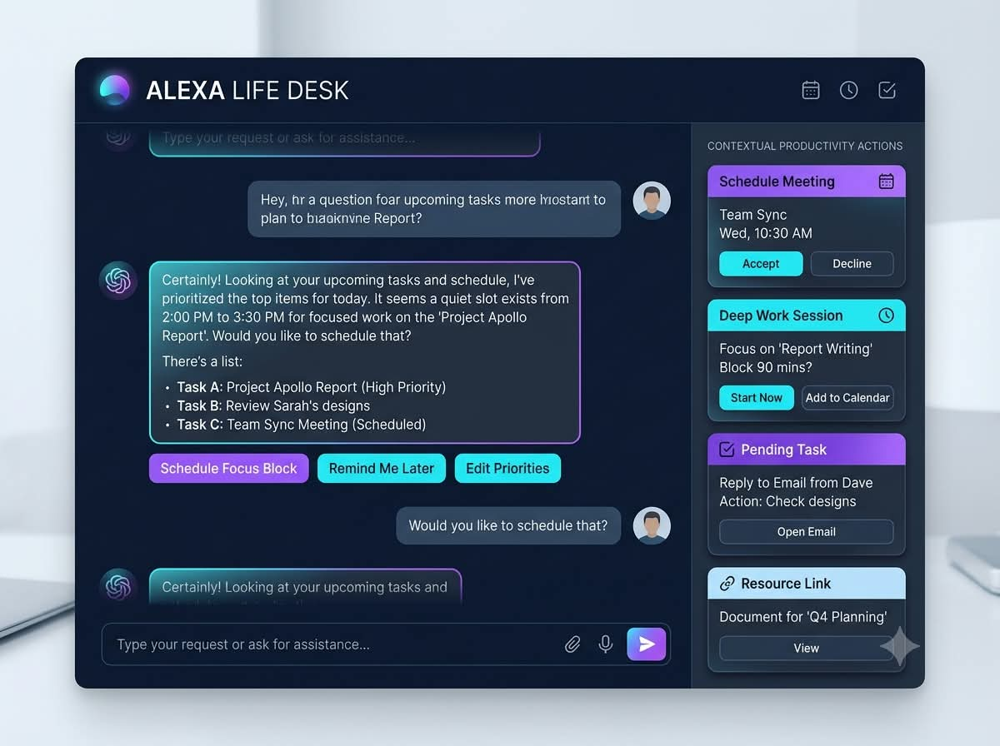
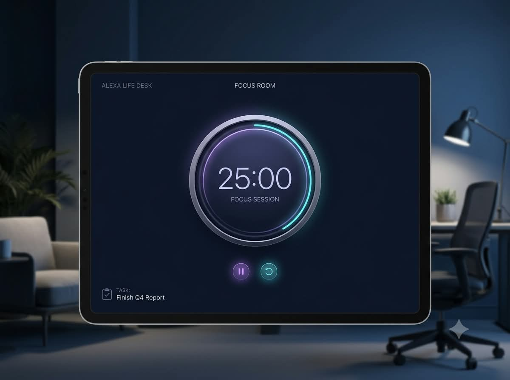
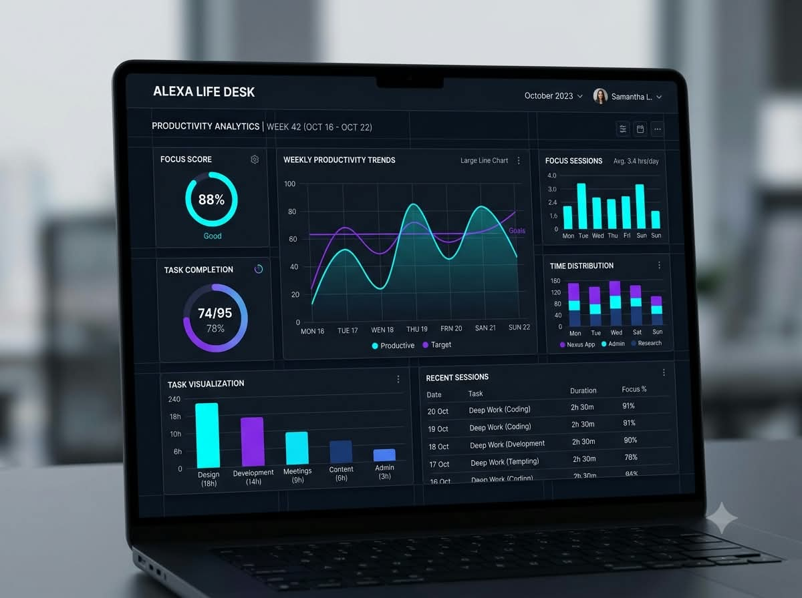
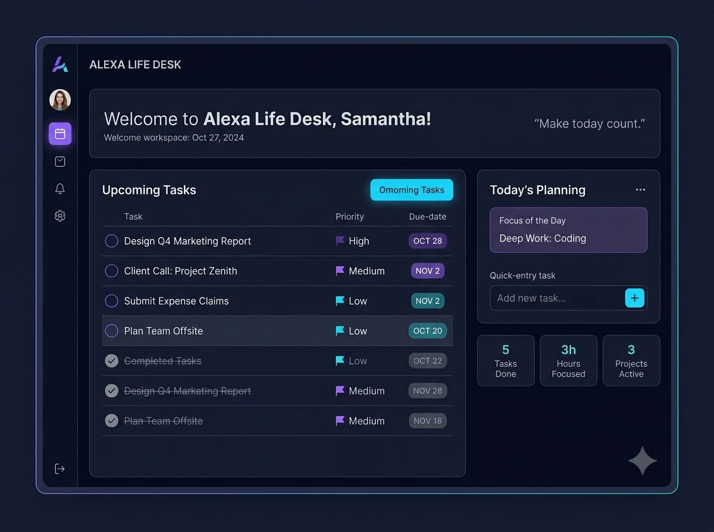

[**🚀 OPEN DASHBOARD**](http://localhost:5173/)  |  [**View Repository**](https://github.com/snehassneha4578-collab/ALEXA-LIFE-DESK)

System.Text.RegularExpressions.MatchEvaluator


# ✨ ALEXA LIFE DESK

<a href="https://readme-typing-svg.demolab.com">
  
</a>

<br>

**A personal dashboard designed to bring focus, organization and useful insights into one workspace.**

<br>

<a href="#-features"></a>
<a href="#-getting-started"></a>
<a href="#-technology-stack"></a>

<br><br>


</div>

---

## 📌 Table of contents

- [About the project](#-about-the-project)
- [Features](#-features)
- [Technology stack](#-technology-stack)
- [Project structure](#-project-structure)
- [Getting started](#-getting-started)
- [Roadmap](#-roadmap)
- [Contributing](#-contributing)

---

## 🌟 About the project

**ALEXA LIFE DESK** is a web-based personal workspace project focused on bringing everyday productivity features together in one dashboard.

The project combines a React-based interface, visual design, and a separate server component. Its interface assets illustrate the assistant, focus, analytics and workspace areas.

### Design goals

- **Clarity:** Keep key information easy to find.
- **Organization:** Bring related productivity features into one interface.
- **Visual consistency:** Use a cohesive dashboard design.
- **Extensibility:** Maintain a codebase that can evolve with future features.

---

## 🚀 Features

Each image below is positioned alongside the feature it represents. The visuals are project assets and are not intended to imply that every illustrated capability has been independently tested.

<table>
<tr>
<td width="48%" valign="middle">

### 🤖 AI assistant

The assistant area is designed around a conversational, AI-oriented experience within the personal workspace.

**Focus:** A dedicated place for assistant interactions and future intelligent workflows.

</td>
<td width="52%" valign="middle">



</td>
</tr>
</table>

<table>
<tr>
<td width="48%" valign="middle">



</td>
<td width="52%" valign="middle">

### 🎯 Focus and productivity

A dedicated visual space for focus-oriented work and productivity activities.

**Goal:** Make it easier to keep attention on the task at hand.

</td>
</tr>
</table>

<table>
<tr>
<td width="48%" valign="middle">

### 📊 Analytics

The analytics area represents a visual way to present productivity-related information and progress.

**Goal:** Make information easier to scan and understand.

</td>
<td width="52%" valign="middle">



</td>
</tr>
</table>

<table>
<tr>
<td width="48%" valign="middle">



</td>
<td width="52%" valign="middle">

### 🗂️ Personal workspace

The workspace concept brings the dashboard's different areas into a consistent environment.

**Goal:** Provide a unified starting point for everyday productivity.

</td>
</tr>
</table>

---

## 🛠️ Technology stack

| Technology | Role |
|---|---|
| React | User interface components |
| Vite | Frontend development and build tooling |
| JavaScript | Application logic |
| CSS | Styling and responsive presentation |
| Node.js | JavaScript runtime for the server component |

The project also includes application assets, icons, configuration files and a dependency lockfile.

---

## 🗺️ Project structure

```text
ALEXA-LIFE-DESK/
├── public/
│   ├── images/
│   │   ├── life-desk-cover.png
│   │   ├── life-desk-hero.png
│   │   ├── life-desk-ai-assistant.png
│   │   ├── life-desk-analytics.png
│   │   ├── life-desk-focus.png
│   │   └── life-desk-workspace.png
│   ├── favicon.svg
│   └── icons.svg
├── server/
│   └── index.js
├── src/
│   ├── assets/
│   ├── App.jsx
│   ├── App.css
│   ├── index.css
│   └── main.jsx
├── .env.example
├── .gitignore
├── index.html
├── package.json
├── package-lock.json
└── vite.config.js
```

---

## 💻 Getting started

### Prerequisites

- Node.js and npm
- Git

### 1. Clone the repository

```bash
git clone https://github.com/snehassneha4578-collab/ALEXA-LIFE-DESK.git
cd ALEXA-LIFE-DESK
```

### 2. Install dependencies

```bash
npm install
```

### 3. Start the frontend development server

```bash
npm run dev
```

Open the local URL printed in your terminal.

### 4. Build the frontend

```bash
npm run build
```

### 5. Run the code checks

```bash
npm run lint
```

The frontend build and lint commands were successful in the earlier project checks. Re-run them after future code changes.

> **Configuration:** Check `.env.example` and the project's code for any required configuration before running optional integrations. Never commit API keys, passwords or populated secret environment files.

---

## 🧭 Roadmap

- [x] React and Vite application structure
- [x] Dedicated project image assets
- [x] Server component included in the repository
- [x] Project source and configuration published on GitHub
- [ ] Verify all core workflows end to end
- [ ] Improve accessibility and responsive behavior
- [ ] Document verified integrations and supported features
- [ ] Set up a public deployment when ready

Roadmap items reflect project direction; unchecked items are not claimed as completed.

---

## 🤝 Contributing

Suggestions and improvements are welcome.

1. Fork the repository.
2. Create a feature branch.
3. Make focused changes.
4. Run the available build and lint checks.
5. Open a pull request describing your changes.

Please do not include secrets, personal credentials or unrelated backup files in contributions.

---

## 📄 License

No license has been specified in this repository yet. Check the repository for a license before reusing or redistributing its code.

---

System.Text.RegularExpressions.MatchEvaluator

### Built with focus and a drive to improve everyday productivity ✨

<a href="#-alexa-life-desk">⬆ Back to top</a>

</div>
